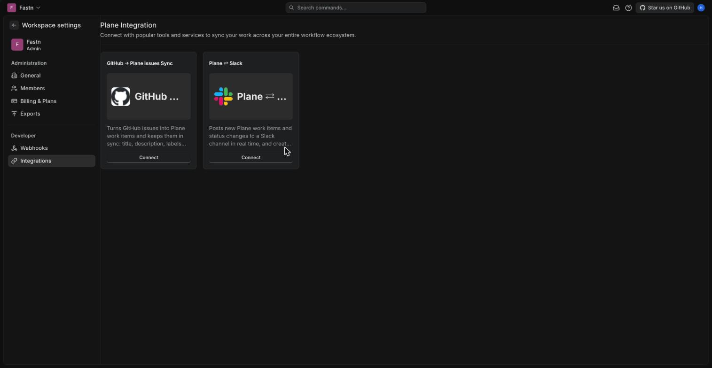
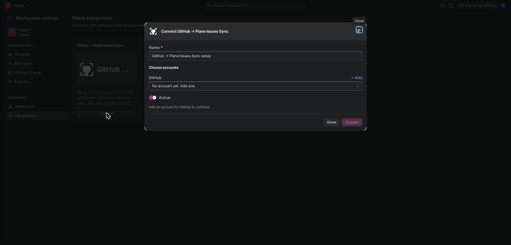

# Plane + fastn integrations

This fork of [Plane](https://github.com/makeplane/plane) embeds the [fastn](https://fastn.ai) integrations hub in Plane's workspace settings. Every Plane workspace gets its own place to connect apps such as GitHub and Slack and run the integrations you build in fastn (for example **GitHub → Plane Issues Sync** or **Plane ⇄ Slack**), without leaving Plane.

## Using it

1. Open **Workspace settings** (the workspace menu in the top-left corner, then **Settings**).
2. Under **Developer**, choose **Integrations**. Every integration your fastn org offers is listed as a card.

   

3. Click **Connect** on a card. Plane opens fastn's connect step in a dialog: add (or pick) the account for the app, keep the setup **Active**, and click **Connect**.

   

4. Once connected, the integration runs on fastn's side. GitHub issues show up as Plane work items, Plane changes post to Slack, and so on, depending on the integration.

You never connect Plane itself: the first time a workspace opens Integrations, Plane connects itself for that workspace (see below).

## How it works

```
Browser (Plane web)                 Plane API                          fastn
-------------------                 ---------                          -----
Settings > Integrations  --POST-->  /api/workspaces/<slug>/fastn/      POST /api/v1/embed/token
                                    embed-token/                --->   (API key stays on the server)
                                      |  creates the workspace's
                                      |  fastn customer on first use
                                      |  and saves its Plane connection --> POST /api/v1/connections
                         <-- iframe URL with a short-lived emb_ token
<iframe> fastn hub (cards view)
  Connect --fastn:open--> Plane opens a dialog with the connect step
  Close   --fastn:close-> Plane closes it and refreshes the cards
```

- **One fastn customer per Plane workspace.** It's created on the first token request (`createIfMissing`), keyed by the workspace id.
- **The fastn API key never reaches the browser.** Plane's API mints a short-lived embed token (8 hours, refreshed inside the frame), and the page only receives the iframe URL.
- **Plane connects itself.** The fastn integrations mark the Plane app as the partner's own product, so the end user only connects the other app. On first load, Plane creates a workspace API token labelled `fastn-integration` and saves it in fastn as that customer's Plane connection.
- **The look comes from fastn.** The page uses a fastn iframe config ("Plane Dark") and theme tokens, so the hub matches Plane's dark UI. Restyle it in fastn's widget builder.

## Setup

### In fastn

1. Build the integrations you want to offer (each one is a fastn widget) in your fastn org.
2. Create an API key for the org (`fsk_...`).
3. Note the Plane connector's id and its API-token auth method id. The connector needs a Plane API token, the workspace slug and the Plane API's base URL.

### In Plane

Follow Plane's own local setup below (`./setup.sh`, `docker compose -f docker-compose-local.yml up`, `pnpm dev`), then add these to `apps/api/.env` and restart the `api` container:

| Variable | What it is |
| --- | --- |
| `FASTN_API_URL` | fastn API host, e.g. `https://api.fastn.dev` |
| `FASTN_API_KEY` | The org's fastn API key (`fsk_...`). Server-side only |
| `FASTN_WIDGET_ID` | Optional. Opens the hub on one integration |
| `FASTN_PLANE_CONNECTOR_ID` | The Plane connector's id in fastn |
| `FASTN_PLANE_AUTH_METHOD_ID` | That connector's API-token auth method id |
| `PLANE_PUBLIC_API_URL` | A URL fastn can reach Plane's API on |

fastn calls Plane's API from the internet, so `PLANE_PUBLIC_API_URL` can't be `localhost`. For local development, a quick tunnel works:

```bash
cloudflared tunnel --url http://localhost:8000
```

The quick-tunnel URL changes each time it starts. Update `PLANE_PUBLIC_API_URL` and restart the API when it does; the connection is saved again on the next page load.

The `.env` files are git-ignored; keep the API key out of the repo.

## What changed from upstream Plane

| File | Change |
| --- | --- |
| `apps/api/plane/app/views/fastn/base.py` | New: the embed-token endpoint and the Plane connection setup |
| `apps/api/plane/app/urls/webhook.py`, `apps/api/plane/app/views/__init__.py` | Route and export for the endpoint |
| `apps/web/app/(all)/[workspaceSlug]/(settings)/settings/(workspace)/integrations/page.tsx` | The Integrations page: hub frame, connect dialog, sizing |
| `apps/web/services/fastn.service.ts` | New: calls the endpoint |
| `apps/web/app/routes/core.ts` | Route for the page |
| `packages/constants/src/settings/workspace.ts`, `packages/types/src/settings.ts`, `apps/web/components/settings/workspace/sidebar/item-icon.tsx` | The **Integrations** entry in the settings menu |

---

<br /><br />

<p align="center">
<a href="https://plane.so">
  
</a>
</p>
<p align="center"><b>Modern project management for all teams</b></p>

<p align="center">
    <a href="https://plane.so/"><b>Website</b></a> •
    <a href="https://forum.plane.so"><b>Forum</b></a> •
    <a href="https://x.com/planepowers"><b>X</b></a> •
    <a href="https://docs.plane.so/"><b>Documentation</b></a>
</p>

<p>
    <a href="https://app.plane.so/#gh-light-mode-only" target="_blank">
      
    </a>
</p>

Meet [Plane](https://plane.so/), an open-source project management tool to track issues, run ~sprints~ cycles, and manage product roadmaps without the chaos of managing the tool itself. 🧘‍♀️

> Plane is evolving every day. Your suggestions, ideas, and reported bugs help us immensely. Do not hesitate to join in the conversation on [Forum](https://forum.plane.so) or raise a GitHub issue. We read everything and respond to most.

## 🚀 Installation

Getting started with Plane is simple. Choose the setup that works best for you:

- **Plane Cloud**
  Sign up for a free account on [Plane Cloud](https://app.plane.so)—it's the fastest way to get up and running without worrying about infrastructure.

- **Self-host Plane**
  Prefer full control over your data and infrastructure? Install and run Plane on your own servers. Follow our detailed [deployment guides](https://developers.plane.so/self-hosting/overview) to get started.

| Installation methods | Docs link                                                                                                                                                                               |
| -------------------- | --------------------------------------------------------------------------------------------------------------------------------------------------------------------------------------- |
| Docker               | [](https://developers.plane.so/self-hosting/methods/docker-compose)         |
| Kubernetes           | [](https://developers.plane.so/self-hosting/methods/kubernetes) |
| All-in-one Docker    | [deployments/aio/community](./deployments/aio/community/README.md) · [docs](https://developers.plane.so/self-hosting/methods/docker-aio)                                                |

`Instance admins` can configure instance settings with [God mode](https://developers.plane.so/self-hosting/govern/instance-admin).

## 🌟 Features

- **Work Items**
  Efficiently create and manage tasks with a robust rich text editor that supports file uploads. Enhance organization and tracking by adding sub-properties and referencing related issues.

- **Cycles**
  Maintain your team’s momentum with Cycles. Track progress effortlessly using burn-down charts and other insightful tools.

- **Modules**
  Simplify complex projects by dividing them into smaller, manageable modules.

- **Views**
  Customize your workflow by creating filters to display only the most relevant issues. Save and share these views with ease.

- **Pages**
  Capture and organize ideas using Plane Pages, complete with AI capabilities and a rich text editor. Format text, insert images, add hyperlinks, or convert your notes into actionable items.

- **Analytics**
  Access real-time insights across all your Plane data. Visualize trends, remove blockers, and keep your projects moving forward.

## 🛠️ Local development

See [CONTRIBUTING](./CONTRIBUTING.md)

## ⚙️ Built with

[](https://reactrouter.com/)
[](https://www.djangoproject.com/)
[](https://nodejs.org/en)

## 📸 Screenshots

  <p>
    <a href="https://plane.so" target="_blank">
      
    </a>
  </p>
  <p>
    <a href="https://plane.so" target="_blank">
      
    </a>
  </p>
  <p>
    <a href="https://plane.so" target="_blank">
      
    </a>
  </p>
  <p>
    <a href="https://plane.so" target="_blank">
      
    </a>
  </p>
   <p>
    <a href="https://plane.so" target="_blank">
      
    </a>
  </p>
</p>

## 📝 Documentation

Explore Plane's [product documentation](https://docs.plane.so/) and [developer documentation](https://developers.plane.so/) to learn about features, setup, and usage.

## ❤️ Community

Join the Plane community on our [Forum](https://forum.plane.so), and use [GitHub issues](https://github.com/makeplane/plane/issues) for bug reports and feature requests. We follow a [Code of conduct](./CODE_OF_CONDUCT.md) in all our community channels.

Feel free to ask questions, report bugs, participate in discussions, share ideas, request features, or showcase your projects. We’d love to hear from you!

## 🛡️ Security

If you discover a security vulnerability in Plane, please report it responsibly instead of opening a public issue. We take all legitimate reports seriously and will investigate them promptly. See [Security policy](./SECURITY.md) for more info.

To disclose any security issues, please [report them privately on GitHub](https://github.com/makeplane/plane/security/advisories/new) or email us at security@plane.so.

## 🤝 Contributing

There are many ways you can contribute to Plane:

- Report [bugs](https://github.com/makeplane/plane/issues/new?template=--bug-report.yaml) or submit [feature requests](https://github.com/makeplane/plane/issues/new?template=--feature-request.yaml).
- Review the [documentation](https://docs.plane.so/) and tell us on the [Forum](https://forum.plane.so) or in a GitHub issue where it is wrong or incomplete.
- Add or update [translations](./CONTRIBUTING.md#contributing-to-language-support).
- Talk or write about Plane or any other ecosystem integration and [let us know](https://forum.plane.so)!
- Show your support by upvoting [popular feature requests](https://github.com/makeplane/plane/issues).

Please read [CONTRIBUTING.md](./CONTRIBUTING.md) for details on the process for submitting pull requests to us.

### Repo activity


### We couldn't have done this without you.

<a href="https://github.com/makeplane/plane/graphs/contributors">
  
</a>

## License

This project is licensed under the [GNU Affero General Public License v3.0](./LICENSE.txt).
